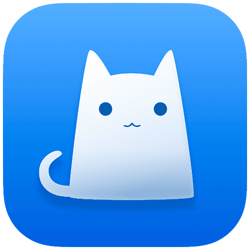

<h1 align="center">
  
  <br>
  ClashX
  <br>
</h1>

<div align="center">

[English](README.md) | [简体中文](README_zh-CN.md)

</div>

## 维护状态

**ClashX 已停止维护，请迁移至 [ClashFX](https://clashfx.com/)。**

本仓库保留现有 ClashX 源代码、发行版本和历史讨论，供已有用户查阅。后续不再计划为 ClashX 开发新功能、适配新系统或提供常规问题修复。本说明不会自动关闭或迁移现有 issue、PR。

- [ClashFX 官网](https://clashfx.com/)
- [下载 ClashFX](https://clashfx.com/download/)
- [ClashX 迁移指南：备份、导入、验证与回退](https://clashfx.com/guides/migrate-from-clashx/)
- [ClashFX 仓库与反馈入口](https://github.com/Clash-FX/ClashFX)

迁移前请确认 ClashFX 的系统要求并备份配置，避免两个客户端同时接管系统代理或 TUN。建议迁移不代表所报告的 ClashX 问题已在 ClashFX 中修复。

ClashFX 当前核心功能可免费使用；ClashFX Pro 正在筹备，尚未开放购买。历史产品 ClashX Pro 与标准 ClashX、筹备中的 ClashFX Pro 是不同产品。

## 历史下载与使用资料

- [ClashX 1.140.0 保留版本](https://github.com/ClashX-Pro/ClashX/releases/tag/1.140.0)
- [ClashX 全部历史发行版本](https://github.com/ClashX-Pro/ClashX/releases)
- [ClashX 网站与保留下载](https://clashx.tech/)
- [配置教程](https://clashx.tech/tutorial)
- [已有问题记录](https://github.com/ClashX-Pro/ClashX/issues)

ClashX 只是代理客户端，不提供代理服务器或订阅服务。服务器可用性和续费问题请联系对应服务商。

## 项目来源

本项目基于 [yichengchen](https://github.com/yichengchen) 原有代码，源码取得自 [bannedbook/ClashX](https://github.com/bannedbook/ClashX)，后续做过 macOS 兼容性修改。原始 git 历史是在重新创建项目时误删 `.git` 目录而丢失的。

[1.140.0 标签源码](https://github.com/ClashX-Pro/ClashX/blob/1.140.0/ClashX/goClash/go.mod)已依赖 mihomo v1.19.24。内核支持某项能力，不代表旧客户端界面已完整提供该功能。本仓库是标准 ClashX，并非历史 ClashX Pro 应用。

## 保留版本的功能说明


- 支持 HTTP/HTTPS 和 SOCKS 协议
- Surge 风格的配置
- GeoIP 规则支持
- 支持 Vmess/Shadowsocks/Socks5/Trojan 协议
- 支持 Netfilter TCP 重定向
- 支持 macOS 10.14+
- 保留历史 macOS 兼容性修改；不再测试或适配后续系统版本

## 📥 安装

已有用户仍可从 [Releases](https://github.com/ClashX-Pro/ClashX/releases) 页面获取历史 ClashX 安装包。

需要仍在维护的客户端时，请查看 [ClashFX](https://clashfx.com/) 和[迁移指南](https://clashfx.com/guides/migrate-from-clashx/)，安装前先确认系统兼容性。

## 历史构建说明

以下步骤仅保留供参考，不再针对后续 Xcode 或 macOS 版本维护。

### 环境要求

- macOS 10.14 或更高版本
- Xcode 15.0+
- Python 3
- Golang 1.21+

### 构建步骤

1. **安装 Golang**
   ```bash
   brew install golang
   # 或从 https://golang.org 下载
   ```

2. **安装依赖**
   ```bash
   bash install_dependency.sh
   ```

3. **打开并构建**
   ```bash
   open ClashX.xcworkspace
   # 在 Xcode 中构建 (Cmd+R)
   ```

## ⚙️ 配置

### 默认路径

默认配置目录为 `$HOME/.config/clash`

默认配置文件名为 `config.yaml`。你可以使用自定义配置名称，并在 `配置` 菜单中切换。

更多详情请查看 [SS-Rule-Snippet for Clash](https://github.com/Hackl0us/SS-Rule-Snippet/blob/master/LAZY_RULES/clash.yaml)。

## 🔧 高级配置

### 修改代理端口号

在菜单栏 → 配置 → 更多设置中修改对应端口号。

### 自定义状态栏图标

将你的图标文件放置在 `~/.config/clash/menuImage.png`，然后重启 ClashX。

### 修改系统忽略列表

进入菜单 → 配置 → 设置 → 绕过这些主机和域名的代理设置。

### URL Schemes

- **导入远程配置：**
  ```
  clash://install-config?url=http%3A%2F%2Fexample.com&name=example
  ```

- **重新加载当前配置：**
  ```
  clash://update-config
  ```

### 获取进程名称

在配置文件中添加以下内容，并将代理模式设置为规则。通过帮助菜单查看日志：

```yaml
script:
  code: |
    def main(ctx, metadata):
      # 记录进程名
      ctx.log('Process Name: ' + ctx.resolve_process_name(metadata))
      return 'DIRECT'
```

### 关闭通知

1. 在系统设置中关闭 ClashX 的推送权限
2. 在菜单栏 → 配置 → 更多设置中选中"减少通知"

**注意：** 强烈不推荐这么做，这可能导致 ClashX 的很多重要错误提醒无法显示。

### 全局快捷键

- 在菜单栏配置 → 更多配置中，自定义对应功能的快捷键（需要 v1.116.1+）
- 或使用 AppleScript 设置，详情点击 [全局快捷键](Shortcuts.md)

## ❓ 常见问题

**问：如何获取带外部 IP 的 shell 命令？**
答：点击 ClashX 菜单图标，然后按 `Option-Command-C`

## 🤝 贡献

ClashX 已停止维护，新功能建议请提交到 [ClashFX](https://github.com/Clash-FX/ClashFX/issues)。现有报告和贡献保留供参考，不承诺继续审查、修复或发布新的 ClashX 版本。

## 📄 许可证

详见 [LICENSE](LICENSE) 文件。

## 🙏 致谢

基于原始 ClashX 项目。
